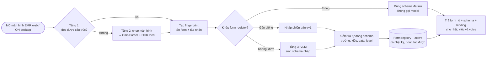
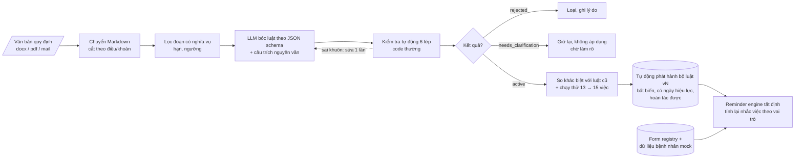

# Detect form & Policy engine – Tổng hợp thiết kế

- **Dự án:** Trợ lý AI nhắc việc theo quy định và nhập liệu bằng giọng nói – Trung tâm Tiêu hóa – Gan mật – Tiết niệu
- **Ngày:** 16/11/2026
- **Phạm vi:** Module 1 (Detect form) và Module 2 (Policy), theo KE_HOACH_CHOT_12-11.md
- **Liên quan:** `TEAM_VISION.md`, `TEAM_ACTION_PLAN.md`, `EVIDENCE_NHAC_VIEC_VOICE.md`

---

## 0. Tóm tắt

| Module | Nguyên tắc | Cách hoạt động |
|---|---|---|
| **1. Detect form** | Dò theo tầng: cách rẻ chạy trước, cách đắt chỉ dùng khi cần | Đọc cấu trúc giao diện → nếu không được thì nhìn ảnh màn hình → so với form registry → form mới thì AI sinh schema, qua kiểm tra tự động thì áp dụng ngay (có nhật ký, hoàn tác được) |
| **2. Policy** | LLM chỉ đọc văn bản, engine cố định ra quyết định | LLM bóc văn bản quy định thành luật JSON có trích dẫn → code kiểm tra 6 lớp → tự động phát hành bộ luật có phiên bản → engine tất định tính nhắc việc |

Hai module gặp nhau ở **form registry**: policy tham chiếu form bằng `form_id`; detect form trả về `form_id`.

**Ràng buộc chung (bắt buộc giữ):**
- Form mới và luật mới được **tự động áp dụng** khi qua kiểm tra tự động; không có bước duyệt thủ công bắt buộc. Thay vào đó: mọi thay đổi đều có nhật ký, phiên bản bất biến và hoàn tác được (quay về phiên bản trước). Mục mơ hồ (`needs_clarification`) và mục bị loại (`rejected`) không được áp dụng.
- Prototype chỉ dùng dữ liệu giả, mock EMR do team dựng; được dùng cloud API.
- Dữ liệu bệnh nhân (cấp 2) không gửi cloud nếu chưa che/mask. Không đưa system prompt, cấu hình nội bộ (cấp 3) vào model bên ngoài.
- Policy và form phải **dynamic**: đổi quy định / gặp form mới không cần sửa code, không khởi động lại.

---

## 1. DETECT FORM

### 1.1 Sơ đồ luồng



### 1.2 Từng bước: công nghệ và cách chạy

| Bước | Công nghệ | Chạy thế nào | Chi phí |
|---|---|---|---|
| **Tầng 1 – web** (cách A) | Extension trình duyệt (content script) đọc DOM | Quét `input, select, textarea, [role=textbox]…` đang hiển thị; lấy nhãn theo thứ tự `<label for>` → `aria-label` → `aria-labelledby` → `placeholder` → chữ cạnh ô; lấy `type`, `required`, đã có giá trị chưa; tên form từ `h1`/`legend`/`document.title`. `MutationObserver` phát hiện chuyển form trong SPA | ms, local, không AI |
| **Tầng 1 – web** (cách B) | Chrome DevTools Protocol qua Playwright/Puppeteer | Chrome mở với `--remote-debugging-port`; gọi `Accessibility.getFullAXTree` → nút có `role`, `name` (nhãn trình duyệt tự tính), `value`, `required`. Cần IT đồng ý mở cổng debug | ms, local |
| **Tầng 1 – desktop OH** | Windows UI Automation: Python `uiautomation` hoặc `pywinauto` (`backend="uia"`) | Lấy cửa sổ phía trước → duyệt cây → lọc `EditControl`, `ComboBoxControl`, `CheckBoxControl` → đọc `Name`, `AutomationId`, `ControlType`, `ValuePattern`, `BoundingRectangle`. Ô không có `Name`: ghép với `TextControl` bên trái/phía trên theo tọa độ. Nghe sự kiện đổi cửa sổ/focus. Kiểm tra trước bằng Accessibility Insights / Inspect.exe | ms, local |
| **Tầng 2** | OmniParser V2 (YOLOv8 + Florence-2, chạy local) + OCR tiếng Việt | Ảnh màn hình → phát hiện vùng ô nhập + OCR nhãn → ghép nhãn–ô theo vị trí. Dùng khi tầng 1 thất bại: giao diện canvas, Citrix/remote desktop, ô không có nhãn, control tự viết | khoảng giây, local, cần GPU/CPU khá |
| **Fingerprint** | Code thường (hash + so khớp tập) | Chuẩn hóa (chữ thường, gộp khoảng trắng, Unicode NFC, **giữ dấu**) → `sha256(tiêu đề + nhãn đã sắp xếp + kiểu)`. Gần đúng: Jaccard trên tập nhãn (ngưỡng ví dụ 0,8, chốt bằng thử nghiệm); có thể thêm embedding tên form | ms |
| **Tầng 3** | VLM: local Qwen3-VL 4B/8B; hoặc cloud (Gemini / GPT / Claude) | Chỉ chạy khi **gặp form mới**. Input: ảnh form (che vùng giá trị) + kết quả tầng 1/2 nếu có. Output: JSON schema form theo structured output. Kết quả qua kiểm tra tự động rồi vào registry với `status: active` | vài giây, tốn tiền/GPU |
| **Xem lại sau** (tùy chọn) | Màn hình admin trong prototype | Quản trị viên có thể xem nhật ký, sửa tên form, alias, trường bắt buộc, `data_level` hoặc hoàn tác về phiên bản trước | – |
| **Form registry** | JSON file hoặc SQLite/Postgres | Nguồn dữ liệu trung tâm, mọi module đọc từ đây | – |

**Khi tầng 1 thất bại phải xuống tầng 2:** UI vẽ bằng canvas; chạy qua remote desktop/Citrix (chỉ có điểm ảnh); ô không gắn nhãn (`Name`/`label` trống); control tự viết không hỗ trợ UI Automation (Win32/Qt cũ).

### 1.3 Tầng 1 đọc những gì (output chung)

| Nguồn | API / thuộc tính dùng | Lấy được |
|---|---|---|
| Web – DOM (extension) | `querySelectorAll` trên ô nhập đang hiển thị; nhãn từ `HTMLInputElement.labels`, `aria-label`, `aria-labelledby`, `placeholder`; `required`, `aria-required`, `value`; `MutationObserver` để bắt chuyển form | Nhãn, kiểu, bắt buộc, đã điền chưa, selector để điền |
| Web – CDP | `Accessibility.getFullAXTree` (hoặc `getPartialAXTree` cho vùng form) | `role`, `name` (nhãn trình duyệt đã tính), `value`, `required`, `backendDOMNodeId` |
| Desktop – UI Automation | Duyệt cây từ cửa sổ phía trước; `ControlType` (Edit, ComboBox, CheckBox, RadioButton), `Name`, `AutomationId`, `ValuePattern`, `BoundingRectangle`; sự kiện focus/cửa sổ thay đổi | Nhãn (hoặc ghép với `TextControl` gần nhất theo tọa độ), kiểu, giá trị, vị trí |

Dù nguồn nào, tầng 1 (và tầng 2) trả về cùng một cấu trúc: `{app, method, title, fields: [{label, type, required, filled, locator}]}`. Cấu trúc này đi vào bước fingerprint.

### 1.4 Hợp đồng dữ liệu: bản ghi form registry

Tách **schema ngữ nghĩa** (dùng chung cho nhắc việc + voice) khỏi **binding giao diện** (chỉ để đọc/điền). Cấu trúc gần FHIR Questionnaire để sau này dễ chuyển đổi.

```json
{
  "form_id": "phieu_sinh_ton_nguoi_lon",
  "version": 2,
  "title": "Bảng theo dõi dấu hiệu sinh tồn cho người lớn",
  "aliases": ["phiếu sinh tồn", "DHST"],
  "status": "active",
  "fingerprint": "sha256:…",
  "fields": [
    {"field_id": "mach", "label": "Mạch", "type": "integer", "unit": "lần/phút", "required": true, "data_level": 2},
    {"field_id": "nhip_tho", "label": "Nhịp thở", "type": "integer", "required": true, "data_level": 2}
  ],
  "bindings": [
    {"app": "mock-emr-web", "method": "dom", "map": {"mach": "[aria-label='Mạch']", "nhip_tho": "#nhipTho"}}
  ],
  "detected_by": "dom",
  "reviewed_by": "…",
  "reviewed_at": "…"
}
```

`status`: `active | retired`. `reviewed_by` / `reviewed_at` chỉ điền khi có người xem lại sau. `data_level`: 1 công khai, 2 ẩn danh/mask, 3 nhạy cảm (theo buổi VinUni 13/11).

### 1.5 Bảo mật
- Tầng 1 chỉ cần nhãn và cấu trúc; đọc giá trị (để kiểm tra thiếu trường) thì xử lý local.
- Ảnh màn hình có dữ liệu bệnh nhân: VLM mặc định chạy local; chỉ gửi cloud khi sinh schema form mới và đã che vùng giá trị (hoặc chụp form trống).

---

## 2. POLICY ENGINE

### 2.1 Sơ đồ luồng



### 2.2 Từng bước: công nghệ và cách chạy

| Bước | Công nghệ | Chạy thế nào |
|---|---|---|
| **Nạp văn bản** | `pandoc` / `python-docx` / `pymupdf` (hoặc `markitdown`) | docx/pdf → Markdown, giữ số điều/khoản; lưu bản gốc + hash để truy vết |
| **Cắt đoạn** | Code thường (regex theo "Điều", "Khoản", số mục) | Mỗi đoạn có `clause_id`; cắt theo đoạn văn là mức hợp lý nhất cho bóc luật |
| **Lọc đoạn** | Regex từ khóa ("phải", "trong vòng", "giờ", "lần/ngày", "trước … giờ") + LLM phân loại nếu cần | Gắn nhãn: nghĩa vụ / ngoại lệ / định nghĩa / khác; bắt mốc thời gian, ngưỡng |
| **Bóc luật** | LLM với structured output (JSON schema) + few-shot. Cloud (prototype) hoặc LLM mở chạy local nếu văn bản không được gửi ra ngoài | Mỗi đoạn → 0..n luật theo Rule DSL (2.3). Mơ hồ thì `needs_clarification`, **không đoán**. Chạy một lần mỗi khi có văn bản mới, cache kết quả |
| **Kiểm tra 6 lớp** | Pydantic / JSON Schema + code thường | Xem 2.4. Không gọi LLM |
| **So khác biệt + chạy thử** | Code thường | So bộ luật mới với bộ đang hiệu lực: thêm / sửa / bỏ. Chạy reminder engine trên bệnh nhân giả với luật cũ và mới → "Bác sĩ A: 13 → 15 việc" |
| **Xem lại sau** (tùy chọn) | Màn hình admin | Quản trị viên xem thay đổi kèm câu trích gốc, xử lý mục `needs_clarification`, hoàn tác khi cần |
| **Phát hành** | DB (SQLite/Postgres) hoặc file JSON có version | Tự động sau khi qua 6 lớp: `ruleset_version` bất biến, ghi thời điểm, văn bản nguồn, `effective_from`; lưu bản diff để hoàn tác |
| **Reminder engine** | Code tự viết: scheduler 7 kiểu lịch + JsonLogic cho điều kiện. Tùy chọn GoRules ZEN cho bảng quyết định (vd ngưỡng sinh tồn bất thường) | Không cache cứng luật: mỗi lần tính đọc bộ luật đang hiệu lực hoặc nghe sự kiện `ruleset_published`. Áp luật × form registry × dữ liệu bệnh nhân → danh sách việc theo người, theo bệnh nhân: đến hạn / quá hạn / thiếu trường. Chạy local, không gọi LLM |

**Kiến trúc đích (cho tài liệu, không cần trong prototype):** ánh xạ form → FHIR `Questionnaire`, luật → FHIR `PlanDefinition` (action timing, condition, tham chiếu Questionnaire), việc cần làm → FHIR `Task`. Rule DSL nên thiết kế để ánh xạ được sang các tài nguyên này.

### 2.3 Hợp đồng dữ liệu: Rule DSL

```json
{
  "rule_id": "R-DAU-02",
  "ruleset_version": "2026-11-16.1",
  "source": {
    "doc_id": "QD-CHAMSOC-2026", "doc_version": "v3", "clause": "Điều 5.2",
    "evidence": "đánh giá lại sau 30 phút đối với thuốc tiêm, truyền"
  },
  "form_id": "phieu_danh_gia_dau",
  "role": ["dieu_duong"],
  "trigger": {"event": "medication_given", "where": {"route": ["tiem", "truyen"], "purpose": "giam_dau"}},
  "condition": null,
  "schedule": {"type": "once_after", "offset": "PT30M"},
  "required_fields": ["diem_dau", "thoi_diem_danh_gia"],
  "priority": "high",
  "effective_from": "2026-11-16",
  "effective_to": null,
  "supersedes": ["R-DAU-01"],
  "status": "active"
}
```

`status`: `active | needs_clarification | rejected`. `condition` viết bằng JsonLogic, ví dụ `{">=": [{"var": "diem_dau"}, 4]}`.

**7 kiểu `schedule` (từ khảo sát 09/11):**

| `type` | Tham số | Ví dụ |
|---|---|---|
| `once_within` | `within` | Bệnh án vào viện trong 24h (`PT24H`) hoặc `end_of_day` |
| `once_after` | `offset` | Đánh giá lại đau sau 30 phút khi dùng thuốc tiêm, truyền |
| `recurring` | `every`, `anchor: last_entry` | Đau thường 6 tiếng/lần, tính từ lần nhập gần nhất |
| `sequence` | `intervals: [1,1,2,2,2,4,4,4,4]` (giờ), `anchor` | Theo dõi sau mổ |
| `daily_before` | `time: "12:00"` | Đánh giá ngã 1 lần/ngày trước 12:00 |
| `min_per_period` | `count`, `period` | Phiếu chăm sóc tối thiểu 4 lần/ngày |
| `on_event` | `events` | Giáo dục sức khỏe lúc nhập viện và ra viện |

Điểm còn mơ hồ phải để `needs_clarification`: đau ≥ 4 điểm mốc 60 phút là tối thiểu hay tối đa; "ngày 2: 6 tiếng/lần" áp dụng thế nào.

### 2.4 Kiểm tra tự động 6 lớp (code thường, không gọi LLM)

| Lớp | Kiểm tra gì | Trượt thì |
|---|---|---|
| 1. Đúng khuôn | Đủ khóa bắt buộc; `schedule.type`, `role` trong danh sách cho phép; thời lượng ISO 8601 (`PT30M`) | Gửi lỗi cho LLM sửa 1 lần; vẫn sai → loại |
| 2. Tham chiếu có thật | `form_id` có trong registry và `active`; `required_fields` ⊂ trường của form; biến trong `condition` có thật; `trigger.event` trong danh mục sự kiện | Loại (chống bịa phiếu/trường) |
| 3. Câu trích nguyên văn | Chuẩn hóa (NFC, chữ thường, gộp khoảng trắng) rồi kiểm tra `evidence` nằm trong đúng đoạn `clause` | Giống ≥ 95%: `needs_clarification`; còn lại: loại |
| 4. Con số khớp trích dẫn | Mọi số trong luật (30, 24, 4…) phải có trong `evidence` | Loại (chống chép sai số) |
| 5. Hợp lý | Thời lượng > 0 và trong khoảng hợp lý (5 phút – 30 ngày); `effective_from ≤ effective_to`; `sequence` không rỗng; JsonLogic chạy được trên bệnh nhân giả | Loại |
| 6. Trùng / xung đột | Gom theo (form + vai trò + sự kiện) với luật đang hiệu lực. Cùng lịch → trùng; khác lịch, hiệu lực chồng nhau → xung đột | Trùng: gộp. Xung đột: tự chọn theo quy tắc (văn bản ban hành sau thắng, đặt `supersedes`), ghi vào nhật ký; không phân giải được → `needs_clarification` |

Thứ tự xử lý: chạy lần lượt lớp 1 → 6. Có lỗi ở bất kỳ lớp nào → `rejected` kèm danh sách lý do. Không lỗi nhưng có cờ (trích dẫn gần đúng, xung đột) → `needs_clarification`. Sạch → `active` (tự động áp dụng). Luật `needs_clarification` và `rejected` không được áp dụng.

### 2.5 Version và tính lại
- Mỗi lần phát hành là một `ruleset_version` bất biến; giữ lịch sử để trả lời "ngày X đang áp dụng luật nào".
- Reminder engine luôn đọc bộ luật đang hiệu lực → đổi luật không cần khởi động lại.
- Việc đã sinh từ luật cũ giữ nguyên lịch sử; việc chưa đến hạn tính lại theo luật mới (cần hỏi người dùng có chấp nhận không).

### 2.6 Kịch bản demo 13 → 15
1. Bộ luật v1 → bác sĩ có 13 việc.
2. Tải văn bản v2 → màn so sánh: +2 luật, 1 luật đổi hạn 24h → trong ngày, mỗi dòng có câu trích gốc.
3. Qua 6 lớp kiểm tra → tự động phát hành v2 (có nút hoàn tác về v1).
4. Màn nhắc việc tự cập nhật 15 việc, hạn tính lại; hiển thị "Đang áp dụng: bộ luật v2, hiệu lực từ …".

### 2.7 Bảo mật
- Văn bản quy định không có dữ liệu bệnh nhân nhưng có thể là tài liệu nội bộ → **chờ mentor xác nhận cấp dữ liệu** trước khi gửi LLM cloud; nếu không được thì bóc luật bằng LLM local (chạy một lần, chấp nhận chậm).
- Reminder engine chạy local hoàn toàn, không gọi LLM.

---

## 3. Gợi ý cấu trúc code cho prototype

```
prototype/
├── mock-emr/                 # web mock EMR, mọi ô nhập có <label for> hoặc aria-label
├── extension/                # content script tầng 1 (đọc DOM + MutationObserver)
├── services/
│   ├── form_detection/       # fingerprint, so khớp registry, gọi VLM tầng 3
│   ├── policy/               # ingest → chunk → filter → LLM extract → validate (6 lớp) → diff
│   └── reminder/             # scheduler 7 kiểu lịch + JsonLogic, đọc ruleset đang hiệu lực
├── data/
│   ├── form_registry/        # bản ghi form (JSON) hoặc DB
│   ├── rulesets/             # v1, v2… bất biến
│   ├── regulations/          # văn bản quy định mẫu v1, v2 (dữ liệu giả)
│   └── patients_mock/        # bệnh nhân giả
├── admin-ui/                 # xem nhật ký, xử lý mục cần làm rõ, hoàn tác form/luật
└── tests/
    ├── gold_rules/           # bộ luật chuẩn làm bằng tay để đo precision/recall
    └── scenario_13_to_15/    # test kịch bản demo
```

**Thứ tự làm đề xuất:**
1. Chốt JSON schema form registry (1.4) và Rule DSL (2.3) – Pydantic models dùng chung.
2. Mock EMR + tầng 1 web + fingerprint + registry (form đã biết).
3. Reminder engine với bộ luật v1 viết tay → hiện 13 việc.
4. Pipeline policy: LLM extract + 6 lớp kiểm tra + diff + tự động phát hành + hoàn tác → v2 → 15 việc.
5. Tầng 3: form mới → VLM sinh schema → kiểm tra tự động → registry.
6. (Nếu kịp) thử pywinauto/uiautomation trên một app Windows để có số đo cho tài liệu.

## 4. Chỉ số cần đo
- **Detect form:** tỷ lệ nhận đúng form; precision/recall trường (nhãn, kiểu, bắt buộc); độ trễ từng tầng; tỷ lệ cache hit; số lần phải sửa hoặc hoàn tác schema sau khi đã tự áp dụng.
- **Policy:** precision/recall luật so với bộ luật chuẩn làm tay; độ chính xác từng trường (form, vai trò, hạn, trường bắt buộc); tỷ lệ luật phải sửa; số luật bị loại do trích dẫn không khớp; thời gian từ nạp văn bản đến nhắc việc cập nhật.