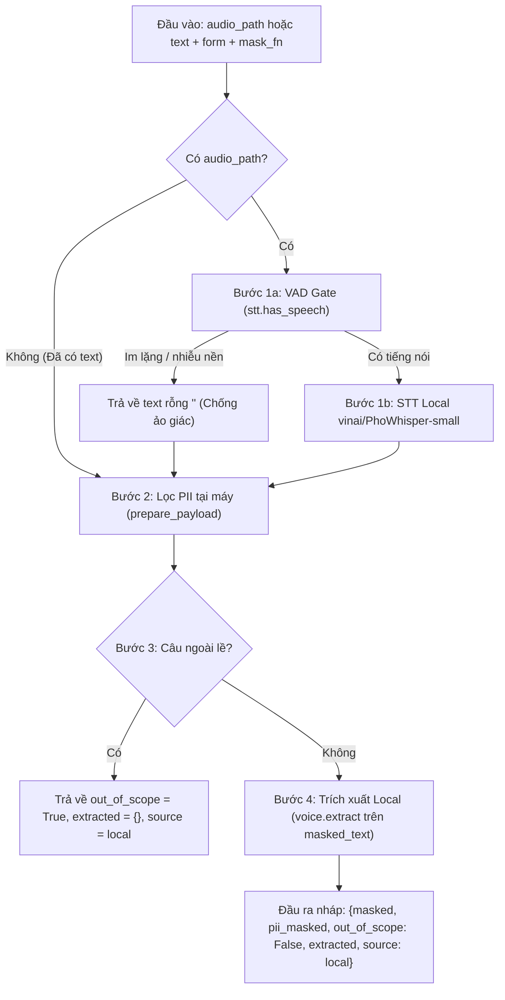

# TỔNG HỢP KẾT QUẢ TRIỂN KHAI: MODULE VOICE INPUT (`features/voice_input`) – 100% LOCAL

| Thông tin | Chi tiết |
|---|---|
| **Tính năng** | Tính năng 2 – Nhập liệu bằng giọng nói (`prototype/features/voice_input/`) |
| **Người thực hiện** | Mai Tiến Huy |
| **Công nghệ & Mô hình** | **100% Local**: VAD (RMS 30ms frame) + `vinai/PhoWhisper-small` + Local PII + Local Extraction |
| **Trạng thái kiểm thử** | **PASS 100%** (`test_voice.py`: 22/22, `test_isolation.py`: 2/2, `test_scenario.py`: 11/11) |

---

## 1. Kiến trúc 100% Local

Toàn bộ pipeline chạy offline tại máy, **không gọi Blaze.vn Cloud STT và không gọi Cloud LLM API**:

| File | Vai trò |
|---|---|
| [stt.py](file:///d:/hospital_ai/prototype/features/voice_input/stt.py) | VAD (RMS 30ms) + STT Local `vinai/PhoWhisper-small` nạp động qua `importlib` + cache RAM `_MODEL_CACHE` + đọc WAV trực tiếp không cần `ffmpeg`. |
| [external_api.py](file:///d:/hospital_ai/prototype/features/voice_input/external_api.py) | Chuẩn hóa payload đã lọc PII (`prepare_payload`) và giữ hợp đồng slot `voice.send` luôn tắt (`send_disabled`). |
| [voice.py](file:///d:/hospital_ai/prototype/features/voice_input/voice.py) | Pipeline 100% Local: STT Local → Lọc PII → Lọc câu ngoài lề → Trích xuất Local (`extract`) cho đủ 10 phiếu EMR & form động. |
| [test_voice.py](file:///d:/hospital_ai/prototype/features/voice_input/test_voice.py) | 22 bài test kiểm chứng VAD, PhoWhisper Local, PII, khớp mờ lỗi STT, đổi số tiếng Việt và cam kết không gọi API ngoài. |
| [README.md](file:///d:/hospital_ai/prototype/features/voice_input/README.md) | Tài liệu sử dụng & kiểm thử cho chế độ 100% Local. |

---

## 2. Luồng hoạt động (End-to-End Local Pipeline)

Xem thêm bộ 10 kịch bản test Happy Case kèm Synthetic Output tại [VOICE_LOCAL_TEST_SCENARIOS.md](file:///d:/hospital_ai/docs/VOICE_LOCAL_TEST_SCENARIOS.md).
